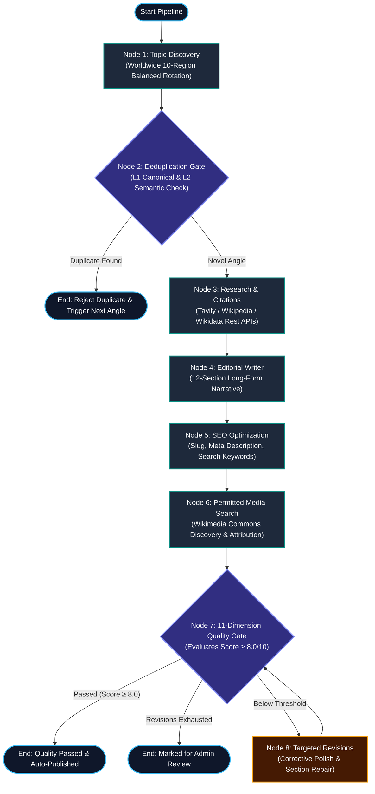

# GlobeTrotter AI — LangGraph Orchestration Architecture

This architecture document presents the complete visual flow and state transition graph of the autonomous multi-agent pipeline powering GlobeTrotter AI.

---

## 1. Compiled LangGraph Visual Graph

The rendered graph diagram generated directly from the compiled LangGraph state machine:

*Direct local image link: [workflow_graph.png](file:///c:/Users/Administrator/Downloads/project_tourist/workflow_graph.png)*

---

## 2. Interactive Mermaid Flowchart

---

## 3. Node Responsibility Breakdown

| Node Name | Module Reference | Primary Responsibility |
| :--- | :--- | :--- |
| **`discover_node`** | `app/graph/nodes/discovery.py` | Rotates through 10 global regions and 13 tourism genres to find balanced, unexplored destinations. |
| **`deduplicate_node`** | `app/graph/nodes/duplicate_check.py` | Computes canonical SHA-256 keys and checks existing topics in PostgreSQL to eliminate duplicate coverage. |
| **`research_node`** | `app/graph/nodes/research.py` | Gathers real-time historical facts, cultural insights, practical logistics, and verifiable citations. |
| **`writer_node`** | `app/graph/nodes/writer.py` | Generates engaging, long-form travel narratives across 12 structured editorial sections. |
| **`seo_node`** | `app/graph/nodes/seo.py` | Produces search-engine-optimized slugs, meta summaries, and taxonomy tags. |
| **`image_node`** | `app/graph/nodes/image_search.py` | Discovers verified, freely licensed imagery with full attribution metadata. |
| **`quality_node`** | `app/services/evaluator_service.py` | Scores the article across 11 criteria (factual depth, structure, tone, voice). Only scores $\ge 8.0$ pass automatically. |
| **`revision_node`** | `app/services/evaluator_service.py` | Performs targeted corrective rewrites if an article scores below the 8.0 threshold before re-evaluation. |
